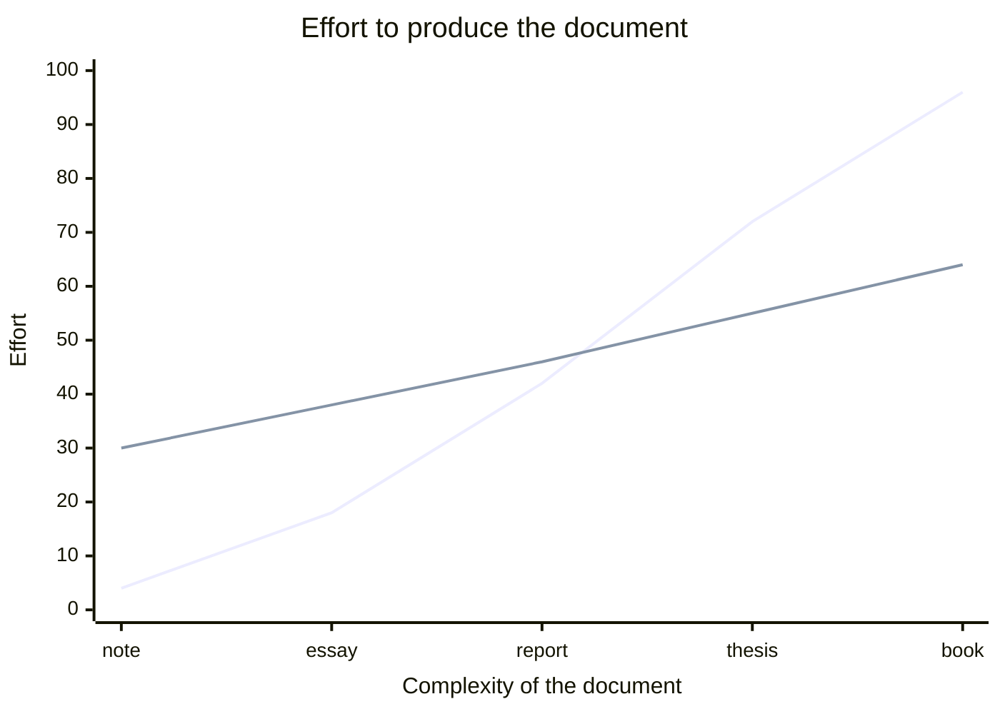

# In two hours, you will have written this

<Placeholder what="checkpoint-04.pdf -- all four pages, side by side" h="300px" />

<div class="mt-4 text-sm opacity-60">
  Title page, table of contents, equations, a table, a figure, a bibliography.
</div>

<!--
10 seconds, not 2 minutes. Show it, say "this is the destination", move on.

The point is not to impress them with the PDF. It is to make the next
two hours feel finite: everything they are about to see is a piece of
THIS, and there is nothing else coming.
-->

---
layout: center
---

# First, who is in the room?

<div class="grid grid-cols-2 gap-8 mt-8 text-xl">

<div class="px-6 py-5 rounded-lg border-2 border-gray-400 border-opacity-40">
<div class="text-4xl mb-2">1</div>
I have never heard of LaTeX
</div>

<div class="px-6 py-5 rounded-lg border-2 border-gray-400 border-opacity-40">
<div class="text-4xl mb-2">2</div>
I have heard of it, never used it
</div>

<div class="px-6 py-5 rounded-lg border-2 border-gray-400 border-opacity-40">
<div class="text-4xl mb-2">3</div>
I have compiled something once
</div>

<div class="px-6 py-5 rounded-lg border-2 border-gray-400 border-opacity-40">
<div class="text-4xl mb-2">4</div>
I use it already
</div>

</div>

<!--
Hands up, 30 seconds. Last year this came out at roughly 95% in groups
1 and 2, so the deck is built for them.

Two reasons to run it anyway:
  - It tells YOU whether to slow down on block 1 or speed through it.
  - It tells THEM that almost nobody in the room knows this yet, which
    is worth a lot at 4pm when everyone assumes they are the only one
    lost.

If a lot of hands go up for 4: give those people the "if you finish
early" tasks straight away and ask them to help their neighbours.
-->

---

# What LaTeX actually is

<div class="grid grid-cols-2 gap-10 mt-6">

<div>

### A word processor

You make it **look** right.

<v-clicks>

- Select the heading, set 16pt bold
- Do it again on the next heading
- Hope they match
- The document is what you see

</v-clicks>

</div>

<div>

### LaTeX

You say what things **are**.

<v-clicks>

- Mark the heading as a heading
- Mark the next one as a heading
- They match, because nobody chose
- The document is what you *meant*

</v-clicks>

</div>

</div>

<div v-click class="aha mt-8">
Everything else today follows from this one trade: you give up direct
control of the appearance, and you get consistency, structure and
automation back.
</div>

<!--
This is the whole philosophical content of the workshop and it takes
90 seconds. Resist the urge to expand it.

If someone asks "so it's like Markdown?" -- yes, same idea, much older
and much more powerful. Good analogy, take it.

Do NOT get drawn into a Word-vs-LaTeX argument here. If it starts, say
"we'll see what it buys you in about ten minutes" and move on; the
table of contents in block 1 makes the case far better than you can.
-->

---

# When it is worth the trouble

<div class="flex justify-center mt-4">



</div>

<v-click>

<div class="grid grid-cols-2 gap-6 mt-2 text-lg">
<div class="nope">
For a one-page note, LaTeX is the slower tool. Say so.
</div>
<div class="aha">
The lines cross around "long enough to have a structure" -- which is
exactly where your coursework lives.
</div>
</div>

</v-click>

<!--
Being honest about the left-hand side of this chart buys you credibility
for the right-hand side. If you tell them LaTeX is always better they
will correctly stop believing you.

The flat-ish LaTeX line is the real claim: the effort barely grows with
the document. That is what they are buying.
-->

---
layout: two-cols
---

# Today: Overleaf

Nothing to install. It compiles in the browser.

1. Account at **overleaf.com**
2. New Project &rarr; Upload Project
3. Drop in the template zip
4. Open `latex-workshop.tex`, hit **Recompile**

<div class="aha mt-6">
Everyone on the same thing for two hours means every problem in this
room is a LaTeX problem, not an installation problem.
</div>

::right::

# Later: on your own machine

<div class="mt-7"></div>

| | Install | Edit in |
|---|---|---|
| Windows | MiKTeX | VS Code, TeXstudio |
| macOS | MacTeX | TeXShop, VS Code |
| Linux | TeX Live | VS Code, TeXstudio |

<div class="mt-6 text-base opacity-80">

Then one command does everything:

```sh
latexmk -pdf latex-workshop.tex
```

</div>

<!--
Two minutes, hard limit. Do not demo an installation.

This slide exists so that nobody spends the workshop installing
software, and so that the people who want to leave with a local setup
have the names written down. That is all it has to do.

The latexmk line matters more than it looks: it is why they will never
have to think about how many compilation passes a document needs.
-->

---
layout: center
---

# Where we are going

<GoalTracker />

<div class="mt-10 text-lg opacity-70">
Five things, four blocks &mdash; the last block brings two of them.
Every block ends with you typing.
</div>

<!--
THE ADVANCE ORGANISER. This slide comes back at the start of every
block with one more item ticked, and at the end with all five green.

Say explicitly: "you will see this slide five more times." It turns a
long session into four short ones, which is the single most useful
thing you can do for a room this tired.

Timing from here: block 1 ends at ~26 min on the clock.
-->
